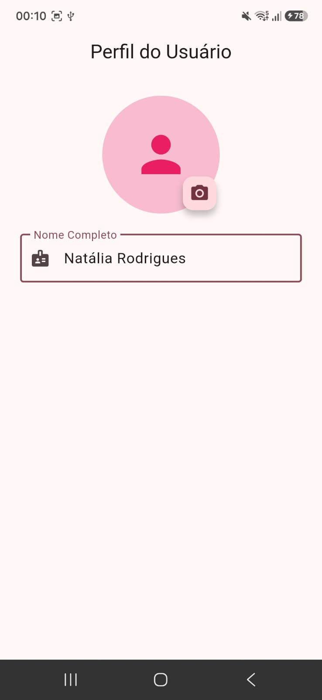

# Aula 15 - Câmera e Galeria de Mídia (Flutter)

Aplicativo desenvolvido na disciplina de Programação para Dispositivos Móveis I utilizando o pacote `image_picker` e o Desafio Básico (Remoção e Reset de Foto no `ModalBottomSheet`).

## Prints de Funcionamento

### Perfil com Foto Selecionada

### Perfil Padrão / Após Remoção da Foto
